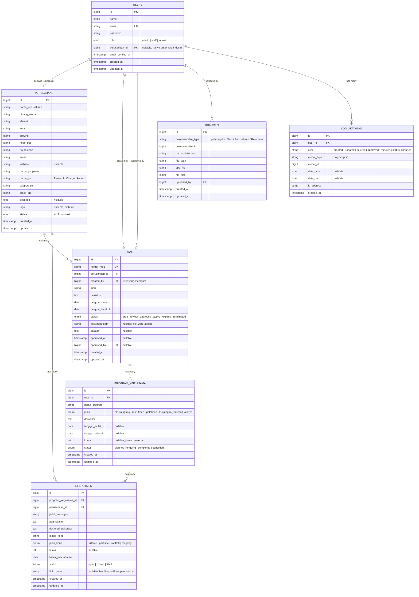
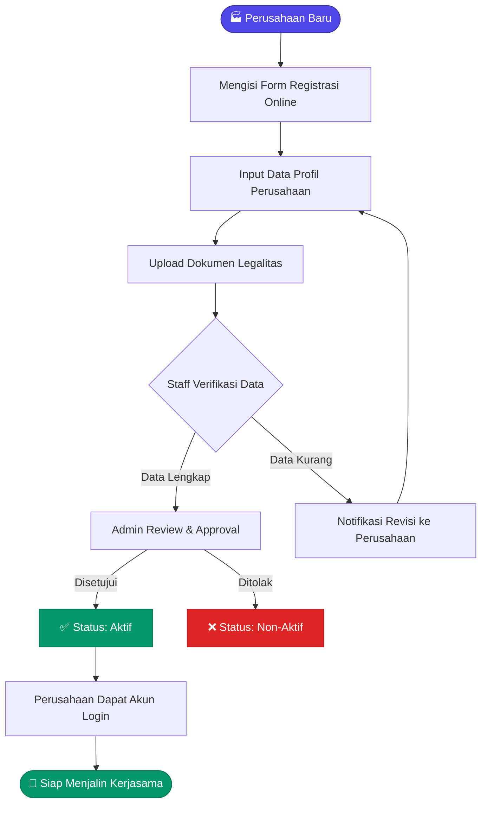
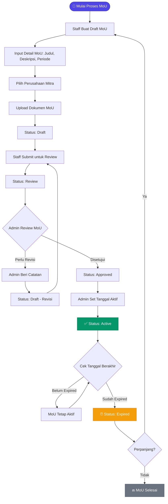
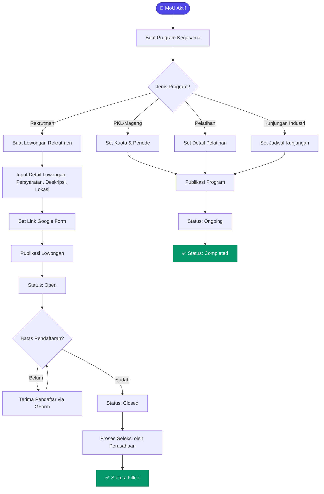
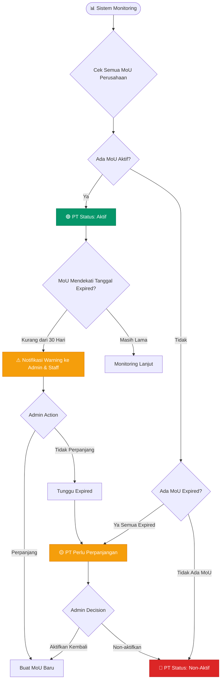

# 🏫 Hubinas & BKK — Sistem Kerjasama Sekolah & Industri

Sistem informasi manajemen kerjasama (MoU) antara sekolah dan industri/perusahaan. Mengelola profil perusahaan mitra, pendaftaran rekrutmen, program kerjasama, serta tracking status aktif/non-aktif dan masa berlaku (expired) kerjasama.

---

## 📋 Daftar Isi

- [Roles & Hak Akses](#-roles--hak-akses)
- [ERD (Entity Relationship Diagram)](#-erd-entity-relationship-diagram)
- [Penjelasan Entitas](#-penjelasan-entitas)
- [Flowchart Sistem](#-flowchart-sistem)
- [Fitur Utama](#-fitur-utama)
- [Tech Stack](#-tech-stack)

---

## 👥 Roles & Hak Akses

Sistem menggunakan **3 role** utama:

| No | Role | Deskripsi | Hak Akses |
|----|------|-----------|-----------|
| 1 | **Admin** | Pengelola utama sistem (Kepala Humas/BKK) | CRUD semua data, approval MoU, manage user, kelola status aktif/non-aktif PT, dashboard & laporan |
| 2 | **Staff** | Staff Hubinas/BKK | Input data perusahaan, buat MoU draft, upload dokumen, kelola program kerjasama & rekrutmen |
| 3 | **Industri** | Perwakilan perusahaan/industri mitra | Lihat & lengkapi profil perusahaan, ajukan program kerjasama, isi form rekrutmen, lihat status MoU |

---

## 📊 ERD (Entity Relationship Diagram)



---

## 📖 Penjelasan Entitas

### 1. `USERS` — Pengguna Sistem
Menyimpan data semua pengguna. Field `role` menentukan level akses (`admin`, `staff`, `industri`). User dengan role `industri` terhubung ke satu perusahaan via `perusahaan_id`.

### 2. `PERUSAHAAN` — Profil Perusahaan Mitra
Data lengkap perusahaan/industri yang menjadi mitra. Termasuk PIC (Person In Charge) sebagai kontak utama. Field `status` mengatur **aktif/non-aktif** perusahaan.

### 3. `MOU` — Memorandum of Understanding
Dokumen perjanjian kerjasama antara sekolah dan perusahaan. Memiliki lifecycle status:
- `draft` → dibuat oleh Staff
- `review` → diajukan untuk ditinjau Admin
- `approved` → disetujui Admin
- `active` → MoU sedang berjalan
- `expired` → sudah melewati `tanggal_berakhir`
- `terminated` → dibatalkan sebelum expired

### 4. `PROGRAM_KERJASAMA` — Program dalam MoU
Setiap MoU bisa memiliki beberapa program (PKL, Magang, Rekrutmen, Pelatihan, Kunjungan Industri, dll). Terhubung ke MoU sebagai induk.

### 5. `REKRUTMEN` — Lowongan & Pendaftaran
Data rekrutmen/lowongan dari perusahaan mitra. Bisa dikaitkan ke program kerjasama. Mendukung **link Google Form** (`link_gform`) untuk pendaftaran eksternal.

### 6. `DOKUMEN` — Dokumen Pendukung (Polymorphic)
Menyimpan file dokumen (PDF MoU, surat perjanjian, dll) yang bisa di-attach ke MoU, Perusahaan, atau Rekrutmen menggunakan polymorphic relation.

### 7. `LOG_AKTIVITAS` — Audit Trail
Mencatat semua aktivitas penting dalam sistem untuk keperluan audit dan tracking.

---

## 🔄 Flowchart Sistem

### Flow 1: Registrasi & Onboarding Perusahaan Mitra



### Flow 2: Pembuatan & Approval MoU



### Flow 3: Program Kerjasama & Rekrutmen



### Flow 4: Monitoring Status Perusahaan (Aktif/Non-Aktif/Expired)



---

## ✨ Fitur Utama

### 🔐 Autentikasi & Otorisasi
- Login multi-role (Admin, Staff, Industri)
- Middleware role-based access control
- Profil pengguna

### 🏢 Manajemen Perusahaan
- CRUD profil perusahaan lengkap
- Upload logo perusahaan
- Status **aktif/non-aktif** perusahaan
- PIC (Person In Charge) sebagai kontak utama

### 📄 Manajemen MoU
- Pembuatan MoU dengan nomor unik
- Workflow approval: `Draft → Review → Approved → Active → Expired`
- Upload dokumen MoU (PDF)
- Tracking masa berlaku & **auto-expired**
- Catatan revisi dari Admin

### 💼 Program Kerjasama
- Multi-program per MoU (PKL, Magang, Rekrutmen, Pelatihan, Kunjungan Industri)
- Tracking status program (Planned → Ongoing → Completed)
- Kuota peserta

### 📝 Rekrutmen & Pendaftaran
- Lowongan rekrutmen dari perusahaan mitra
- Integrasi **Google Form** untuk pendaftaran
- Jenis kerja: Fulltime, Parttime, Kontrak, Magang
- Batas pendaftaran & kuota

### 📁 Manajemen Dokumen
- Upload multi-dokumen (polymorphic)
- Attach ke MoU, Perusahaan, atau Rekrutmen

### 📊 Dashboard & Monitoring
- Statistik jumlah perusahaan aktif/non-aktif
- Statistik MoU per status
- **Warning expired** (< 30 hari)
- Log aktivitas / audit trail

---

## 🛠 Tech Stack

| Layer | Teknologi |
|-------|-----------|
| Backend | Laravel 12.x (PHP 8.2+) |
| Frontend | Blade Templates + Vite |
| Database | MySQL / MariaDB |
| Auth | Laravel Breeze / Fortify |
| File Storage | Laravel Storage (local/S3) |
| UI Framework | Bootstrap 5 / Tailwind CSS |

---

## 🚀 Instalasi & Setup

```bash
# Clone repository
git clone <repo-url>
cd sistem-kerjasama

# Install dependencies
composer install
npm install

# Setup environment
cp .env.example .env
php artisan key:generate

# Setup database
php artisan migrate --seed

# Jalankan
npm run dev
php artisan serve
```

---

## 📜 License

The Laravel framework is open-sourced software licensed under the [MIT license](https://opensource.org/licenses/MIT).
